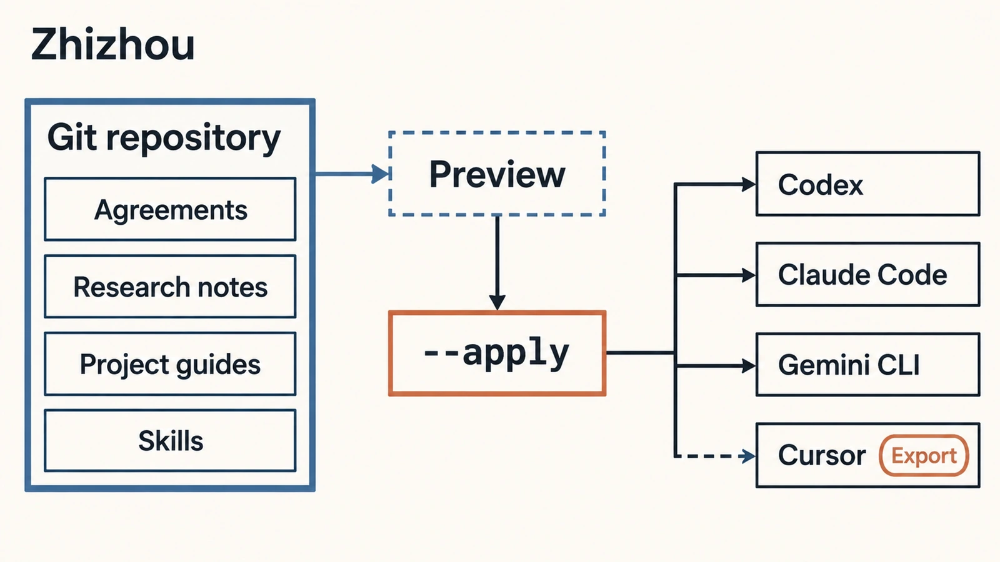

<!-- README_SYNC: source=bb1571b65bc930204b1d4648f5a1c3eed1646bd6; updated=2026-11-18 -->

[简体中文](./README.md) · English

# Zhizhou · 知舟

Keep your AI working agreements, research notes, project guides, and complete skills in Git. When you move to another machine or client, preview the paths the installer will change, then set up Codex, Claude Code, Cursor, or Gemini CLI from the same repository.

[Star Zhizhou](https://github.com/LikC1606/zhizhou/stargazers) to revisit the layout or migration workflow.

[](https://github.com/LikC1606/zhizhou/stargazers)
[](https://github.com/LikC1606/zhizhou/commits/main/)
[](./zhizhou)
[](./LICENSE)



## Inspect before installing

You need Git and Python 3. The installer uses the standard library. This repository contains the maintainer's rules and project history, so start with the [memory index](./memory/INDEX.md) and adapt the contents to your own work if you reuse the layout.

```bash
git clone https://github.com/LikC1606/zhizhou.git
cd zhizhou
./zhizhou check
./zhizhou install
```

`check` verifies memory entries, skills, and registered snapshots. `install` previews the files it would write; apply only after reviewing the plan:

```bash
./zhizhou install --apply
```

Client entry points refer to the memory index in this checkout. If you move it, reinstall to update those links. You can also preview a narrower install:

```bash
./zhizhou install --tools codex claude
./zhizhou install --project /path/to/project --tools all
./zhizhou install --home /path/to/user-home
```

## Where clients read their instructions

| Client | User rules | Skills |
| --- | --- | --- |
| Codex | `$CODEX_HOME/AGENTS.md`, defaulting to `~/.codex/AGENTS.md` | `~/.agents/skills/` |
| Claude Code | `~/.claude/CLAUDE.md` | `~/.claude/skills/` |
| Cursor | Export to `~/.zhizhou/cursor-user-rules.md`; paste into User Rules | `~/.agents/skills/` |
| Gemini CLI | `~/.gemini/GEMINI.md` | `~/.agents/skills/` |

Project installs can generate `AGENTS.md`, `CLAUDE.md`, `GEMINI.md`, and Cursor `.mdc` files. Project snapshots remain scoped to their source and are not deployed in bulk. Pass a path configuration with `--machine` for a different disk layout and set up external tools and service authentication separately. See the [adapter guide](./docs/adapters.md) and [migration guide](./docs/migration.md). Open a fresh client session to verify that the intended instructions actually load.

## Record a working agreement

Search first, then record a source, scope, and status. Use `global` for general habits, `research` for research practice, or `project:<id>` for local constraints. Notes default to `pending`. Mark them `confirmed` only after explicit agreement, and leave a reason when replacing a rule.

```bash
rg -n 'keyword' memory skills projects clients
./zhizhou note 'Record review scope' \
  --scope project:example \
  --source 'Design review notes' \
  --body 'Use the agreed review scope for this project.'
```

To bring an updated skill and its supporting files back from a local installation, preview the import first:

```bash
./zhizhou import-skills /path/to/skills
./zhizhou import-skills /path/to/skills --apply
./zhizhou check
git diff
```

The installer preserves text outside its managed regions and stops on conflicting local edits to a managed region or skill. Sync explicitly through Git or your backup process. Sessions, secrets, and large run artifacts stay outside the knowledge base. See the [maintenance agreements](./memory/maintenance.md).

## Repository map

| Entry | Contents |
| --- | --- |
| [Memory](./memory/INDEX.md) | Working agreements, research navigation, and sourced notes |
| [Skills](./skills/) | Workflows, scripts, and supporting resources |
| [Projects](./projects/README.md) | Guides, scoped skills, protocols, and snapshots |
| [Clients](./clients/README.md) | Scoped rules, agent definitions, and plugin recovery material |
| [Sources](./sources/) and [machine settings](./machines/) | Origins, versions, content summaries, and storage layouts |
| [Coverage](./docs/coverage.md) and [verification](./docs/verification.md) | Inventory, isolated tests, and migration results |

```bash
./zhizhou check
python3 -m unittest discover -s tests -v
```

The launcher prefers `/usr/bin/python3`; override it with `ZHIZHOU_PYTHON` if needed. The previous `./lzh-memory` entry point and states remain compatible. File migration checks do not establish that clients load or follow the rules.

## License and citation

The original installer, tests, and original documentation are under the [MIT License](./LICENSE); see [NOTICE.md](./NOTICE.md) for scope. Bundled skills, project snapshots, and assets keep their own licenses and credits in [THIRD_PARTY_NOTICES.md](./THIRD_PARTY_NOTICES.md). Maintainer and citation information is in [CITATION.cff](./CITATION.cff).

Report reproducible migration or client entry problems in [Issues](https://github.com/LikC1606/zhizhou/issues).
